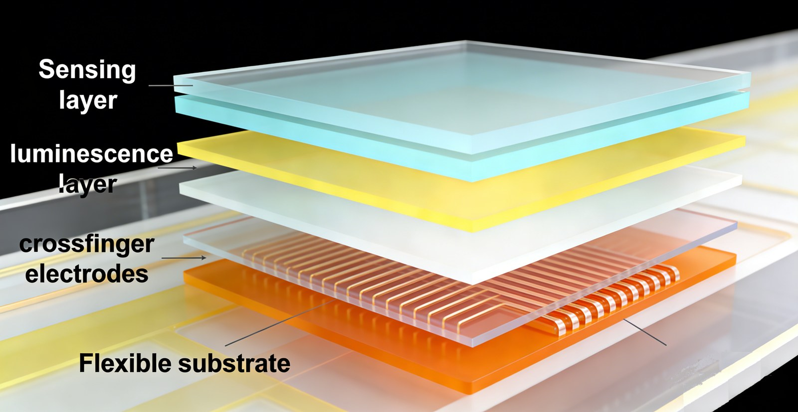
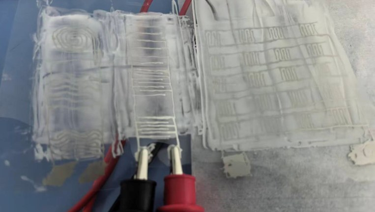
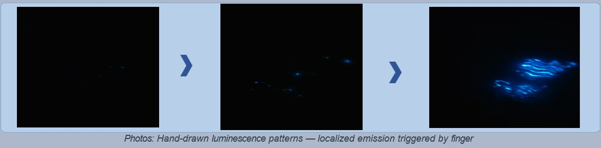

# Printable OLED Humidity Sensor

**Printable organic light-emitting diodes for transparent display and visualized humidity sensing**

Laboratory-stage work from an unpublished 2026 manuscript by Maximilian B. Kopp.

## Overview

This repository documents a printable organic light-emitting diode (OLED) platform that combines a transparent, flexible display with visualized humidity sensing. Devices are fabricated with a hybrid, lithography-free process: inkjet printing for the electrodes and blade coating for the functional layers. The work is at the laboratory stage.

The manuscript describes potential applications in automotive head-up displays (HUDs), smart packaging, wearable electronics, and smart homes. Those uses are presented here only as potential applications discussed in the manuscript, not as products or commercial claims.

## Device architecture

As stated in the abstract and in section 4.1, the multilayer stack is:

1. Flexible PET substrate
2. Inkjet-printed silver nano-particle interdigitated (cross-finger) electrodes
3. Blade-coated dielectric layer
4. Blade-coated organic emitting layer
5. Blade-coated humidity-responsive interactive layer

Under an applied AC or DC bias, charge carriers injected from the interdigitated electrodes recombine in the emitting layer and produce light. The top humidity-responsive layer is hygroscopic; the manuscript states that changes in ambient humidity modulate its ionic conductivity or dielectric constant, which in turn changes the luminescent intensity, so that humidity is read out as a visible brightness change. The same field-perturbation principle is used for non-contact interaction (a wet finger or a nearby object locally triggering emission).

## Fabrication process and parameters

Process details are taken from section 4.2. Materials listed with “e.g.” are recorded as the manuscript states them.

- **Substrate.** Flexible PET is cleaned in an ultrasonic bath with acetone and then isopropyl alcohol, and dried with nitrogen.
- **Bottom electrodes (inkjet printing).** An Epson R230 piezoelectric inkjet printer or equivalent deposits silver nano-particle ink (e.g., Mitsubishi Paper Mills) as a cross-finger array. Stated optimized parameters: nozzle diameter 30–90 µm, printing speed 1–2 mm/s, curing at 80–120 °C for 30 min, electrode spacing 0.5 mm.
- **Dielectric layer (blade coating).** Dielectric ink (e.g., LUMI-DE10U). Blade height 150–200 µm, coating speed 5 mm/s, curing at 120 °C for 30 min.
- **Emitting layer (blade coating).** Organic electroluminescent ink (e.g., LUMI-AB50S). Blade height 100–150 µm, coating speed 5 mm/s, annealing at 120 °C for 30 min.
- **Humidity-interactive layer (blade coating).** Humidity-responsive ink (e.g., LUMI-MW10B), dried at 100 °C for 10 min.

## Key Results

Values below are only those stated in the manuscript. The work is at the laboratory stage.

| Quantity | Value | Source |
|----------|-------|--------|
| Maximum luminance | exceeds 2350 cd/m² | abstract and §5.1 |
| Humidity response range | 30–90% RH | abstract, §3.2, and §5.2 |
| Humidity sensitivity | up to 52%, defined in the manuscript as the relative change in intensity per unit RH change | §5.2 |
| Luminance retained when bent to a 90° curvature radius | over 85% of initial luminance | §5.1 |
| Repeated bending | performance remains stable over >200 cycles | §5.1 |
| Interactive function durability | up to 2,000 wetting–dewetting cycles tested | §5.3 |
| Electrode spacing | 0.5 mm | §3.2 and §4.2 |

Section 5.1 also reports high optical transparency in the off-state and good thickness uniformity of the blade-coated layers across centimeter-scale areas. Section 5.3 describes hand-drawn luminescent patterns from wet-finger motion and proximity-triggered emission.

## Figures from the manuscript

Full captions are in [`figures/paper/README.md`](figures/paper/README.md).

*From Kopp, M. B., Printable Organic Light-Emitting Diodes for Transparent Display and Visualized Sensing. Unpublished manuscript (2026), Maximilian B. Kopp.*



*Manuscript Figure 1 (§4.2): Figure Layout of Substrate. Exploded schematic of the flexible substrate, cross-finger electrodes, luminescence layer, and sensing layer.*



*Manuscript Figure 2 (§5.2): Device Array Testing in Light. Laboratory photograph of printed electrode arrays under test.*



*Manuscript Figure 3 (§5.3): Photos: Hand-drawn luminescence patterns — localized emission triggered by finger. Caption as printed on the figure.*

## Citation

Kopp, Maximilian B. *Printable Organic Light-Emitting Diodes for Transparent Display and Visualized Sensing.* Unpublished manuscript (2026), Maximilian B. Kopp.

## How to reproduce

```bash
python src/reproduce_stated_results.py
```

The script loads the packaged CSVs and checks that the stated values (luminance threshold, humidity range, sensitivity wording, bend-test figures, cycle counts, electrode spacing, and process ranges) match the manuscript prose transcribed in `data/`.

CSV header comments name the manuscript section for every number. See `data/NOTES.md`.

## Repository Structure

```
printable-oled-humidity-sensor/
├── data/               # Numbers stated in the manuscript
├── figures/paper/      # Figures from the manuscript
├── src/                # reproduce_stated_results.py
├── README.md
├── requirements.txt
└── LICENSE
```

## License

Source code in this repository is licensed under the MIT License. See [LICENSE](LICENSE).

Figures and data are © Maximilian Kopp.

## Contact

**Maximilian Kopp** — [maxkopp2007@gmail.com](mailto:maxkopp2007@gmail.com) | [maxkopptech.com](https://www.maxkopptech.com) | [ORCID](https://orcid.org/0009-0008-6431-8137) | [Google Scholar](https://scholar.google.com/citations?user=TrKuDMsAAAAJ) | [LinkedIn](https://www.linkedin.com/in/maxkopp)
